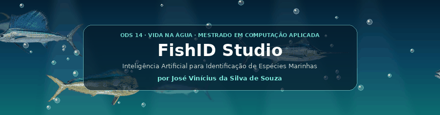
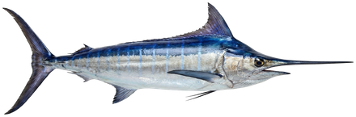
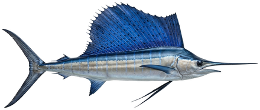
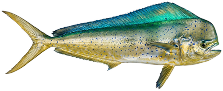
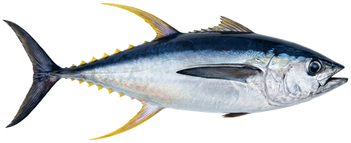
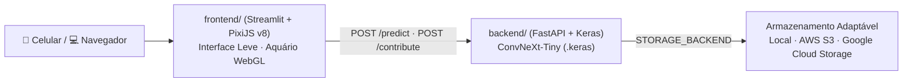

<p align="center">
  
</p>

<h1 align="center">🐟 FishID Studio</h1>

<p align="center">
  <strong>Pesquisa de Mestrado · Modelo Deep Learning para Identificação de Espécies de Peixes Marinhos</strong><br/>
  Projeto <em>Open Source</em> desenvolvido por <a href="https://github.com/viniciusscience"><strong>José Vinícius da Silva de Souza</strong></a>
</p>

<p align="center">
  
  
  
  
  
  
</p>

**FishID Studio** é uma plataforma aberta de visão computacional voltada à **identificação automatizada de grandes peixes migratórios marinhos** por meio de fotos, câmera de celular e vídeos. O projeto nasceu como pesquisa de mestrado em Computação Aplicada, combinando rigor científico (*ConvNeXt-Tiny*, explicabilidade via *Grad-CAM*, auto-segmentação *YOLO-World + SAM 2* e rastreamento *ByteTrack*) com uma interface imersiva em **PixiJS v8 WebGL** responsiva para empresas, pesquisadores e ciência cidadã.

---

## 🌊 Destaques Visuais do Aquário Interativo

A interface traz um aquário **WebGL 60 FPS** construído com **PixiJS v8** e malha deformável (`PIXI.MeshRope`), onde grandes espécies pelágicas fotorrealistas nadam com ondulação orgânica de cauda, raios cáusticos de luz solar e colunas de microbolhas atrás dos painéis translúcidos:

| Marlim-azul (*Makaira nigricans*) | Agulhão-vela (*Istiophorus platypterus*) | Dourado-do-mar (*Coryphaena hippurus*) | Albacora-laje (*Thunnus albacares*) |
| :---: | :---: | :---: | :---: |
|  |  |  |  |

---

## 🌍 Alinhamento com os ODS da ONU (Agenda 2030)

Esta pesquisa contribui diretamente para os **Objetivos de Desenvolvimento Sustentável (ODS)** da ONU:

- **🌊 ODS 14 — Vida na Água:** apoia a conservação e o uso sustentável dos oceanos e recursos marinhos, facilitando o monitoramento taxonômico de grandes peixes migratórios e o combate à pesca predatória ou não reportada.
- **⚙️ ODS 9 — Indústria, Inovação e Infraestrutura:** aplica Inteligência Artificial de ponta de forma aberta e acessível ao setor pesqueiro e acadêmico.
- **♻️ ODS 12 — Consumo e Produção Responsáveis:** fortalece a rastreabilidade e a transparência na identificação de espécies marinhas.

---

## 🐠 Espécies Reconhecidas Atualmente (10 Espécies Pelágicas)

O modelo atual foi treinado com mais de **6.200 imagens** distribuídas entre 10 grandes espécies migratórias:

| # | Nome Popular (PT-BR) | Nome Científico | Grupo |
| :-: | :--- | :--- | :--- |
| 1 | **Dourado-do-mar** | *Coryphaena hippurus* | Pelágico |
| 2 | **Agulhão-vela (Peixe-vela)** | *Istiophorus platypterus* | Peixe de bico |
| 3 | **Agulhão-branco (Marlim-branco)** | *Kajikia albida* | Peixe de bico |
| 4 | **Bonito-listrado** | *Katsuwonus pelamis* | Atum |
| 5 | **Agulhão-negro (Marlim-azul)** | *Makaira nigricans* | Peixe de bico |
| 6 | **Agulhão-verde (Bico-longo)** | *Tetrapturus pfluegeri* | Peixe de bico |
| 7 | **Albacora-branca** | *Thunnus alalunga* | Atum |
| 8 | **Albacora-laje** | *Thunnus albacares* | Atum |
| 9 | **Albacora-bandolim** | *Thunnus obesus* | Atum |
| 10 | **Espadarte (Meca)** | *Xiphias gladius* | Peixe de bico |

---

## ✨ Principais Recursos

- **🌊 Aquário WebGL Realista (`PixiJS v8`):** peixes pelágicos fotorrealistas com nado articulado via `MeshRope`, 3 planos de profundidade, raios cáusticos e colunas de microbolhas.
- **📸 Captura pela Câmera do Celular e Upload:** interface 100% responsiva pensada para uso rápido em campo, embarcações e empresas.
- **🐠 Galeria Interativa:** navegação sob demanda com filtro por espécie e sorteio instantâneo para demonstração.
- **🎥 Análise de Vídeos (MP4 / MOV):** anotação automática frame a frame com OpenCV, conversão H.264 via `ffmpeg`, resumo por espécie e download do vídeo anotado.
- **🤝 Aprendizado Contínuo com Filtro de Qualidade:** validação automática de nitidez, brilho, contraste e resolução (`backend/storage.py`) separando fotos confirmadas de revisão humana, com armazenamento adaptável (**Local**, **AWS S3 / R2** ou **Google Cloud Storage**) controlado via variáveis de ambiente.
- **🔬 Pipeline Científico Reprodutível:**
  - `ConvNeXt_Tiny_Otimizado_Mestrado.ipynb` — preservação morfológica (`resize_with_pad`), `mixed_float16`, `CosineDecay`, `MixUp`, `TTA` e **Grad-CAM comparativo**.
  - `segmentar_peixes_auto.py` — auto-segmentação e recorte turbo em lote (`YOLO-World` + `SAM 2.1`, FP16 e I/O paralelo).
  - `rastrear_peixes_auto.py` — rastreamento multi-peixe em vídeo (`YOLO-World` + `ByteTrack`), CSV de trajetórias e auto-rotulagem YOLO.

---

## 🏗️ Arquitetura do Projeto



```text
projeto-mestrado/
├── backend/                               # API FastAPI + Modelo Keras + Pipeline de Coleta
│   ├── main.py                            # Endpoints /health, /info, /predict e /contribute
│   ├── storage.py                         # Validação de qualidade + storage (local | s3 | gcs)
│   ├── requirements.txt                   # Dependências do backend
│   ├── Dockerfile                         # Container do backend
│   └── models/                            # Coloque aqui o arquivo modelo.keras
│
├── frontend/                              # Interface Web FishID Studio (leve, sem TensorFlow)
│   ├── app.py                             # Aplicação Streamlit + Aquário WebGL PixiJS v8
│   ├── requirements.txt                   # Dependências leves da interface
│   ├── packages.txt                       # Dependências de sistema (ffmpeg, fonts-dejavu-core)
│   ├── Dockerfile                         # Container do frontend
│   ├── .streamlit/config.toml             # Tema visual Clean Studio
│   └── assets/bg/*_real.png               # Sprites fotorrealistas transparentes dos peixes
│
├── docs/
│   └── fishid_aquarium_banner.gif         # Banner animado do aquário para apresentação
│
├── docker-compose.yml                     # Orquestração local (frontend + backend)
├── .env.example                           # Modelo limpo de variáveis de ambiente
├── ConvNeXt_Tiny_Otimizado_Mestrado.ipynb # Notebook de treinamento e análise Grad-CAM
├── segmentar_peixes_auto.py               # Auto-segmentação em lote (YOLO-World + SAM 2.1)
├── rastrear_peixes_auto.py                # Rastreamento multi-peixe em vídeo (ByteTrack)
└── LICENSE                                # Licença MIT e Direitos Autorais
```

---

## 💻 Execução Local (Docker)

1. Copie o modelo de variáveis de ambiente:

```bash
cp .env.example .env
```

2. Suba a aplicação localmente:

```bash
docker compose up --build
```

- **Interface Web:** `http://localhost:8080`
- **API / Documentação Swagger:** `http://localhost:8000/docs`

> Todas as integrações (modelo `.keras`, destino de coleta `STORAGE_BACKEND=local|s3|gcs`, galeria opcional, contatos e apoio à pesquisa) são configuradas exclusivamente pelo arquivo `.env` local (ignorado pelo Git).

---

## ☕ Apoie a Pesquisa Científica

O **FishID Studio** é um projeto acadêmico **100% aberto e gratuito**. Se a ferramenta auxiliou sua pesquisa, empresa ou iniciativa de conservação marinha, considere apoiar o desenvolvimento contínuo pelo botão **☕ Apoie a Pesquisa** no topo da interface — cada incentivo fortalece a ciência aberta brasileira!

---

## 📖 Como Citar e Referências

```bibtex
@misc{souza2026fishidstudio,
  author       = {José Vinícius da Silva de Souza},
  title        = {FishID Studio: Modelo Deep Learning para Identificação de Espécies de Peixes Marinhos},
  year         = {2026},
  note         = {Projeto Open Source de Pesquisa de Mestrado em Computação Aplicada}
}
```

- **Liu, Z. et al. (2022).** *A ConvNet for the 2020s (ConvNeXt).* IEEE/CVF CVPR.
- **Selvaraju, R. R. et al. (2017).** *Grad-CAM: Visual Explanations from Deep Networks via Gradient-based Localization.* ICCV.
- **Álvarez-Ellacuría, A. et al. (2019).** *Image-based, unsupervised estimation of fish size from commercial landings using deep learning.* ICES Journal of Marine Science.
- **Froese, R. (2006).** *Cube law, condition factor and weight-length relationships: history, meta-analysis and recommendations.* Journal of Applied Ichthyology, 22(4), 241–253.

---

## ©️ Direitos Autorais e Licença

**Copyright © 2026 José Vinícius da Silva de Souza.** Todos os direitos reservados conforme os termos da **Licença MIT** ([LICENSE](LICENSE)).

- **Uso do código-fonte:** livre para uso acadêmico, educacional, comercial, modificação e redistribuição, **desde que mantido o aviso de direitos autorais e atribuição ao autor original e à pesquisa de mestrado**.
- **Bases de dados e imagens:** as imagens de treinamento provenientes de fontes abertas (como *iNaturalist* e *FishBase*) seguem suas respectivas licenças originais. Fotos enviadas voluntariamente pelos usuários por meio do recurso *"Aprendizado contínuo"* são coletadas mediante consentimento explícito exclusivamente para fins de pesquisa científica, aprimoramento do modelo e expansão do catálogo de espécies.
- **Aviso técnico:** as identificações geradas pelo modelo têm caráter de apoio à decisão e monitoramento científico, não substituindo laudos taxonômicos oficiais em contextos regulatórios.
